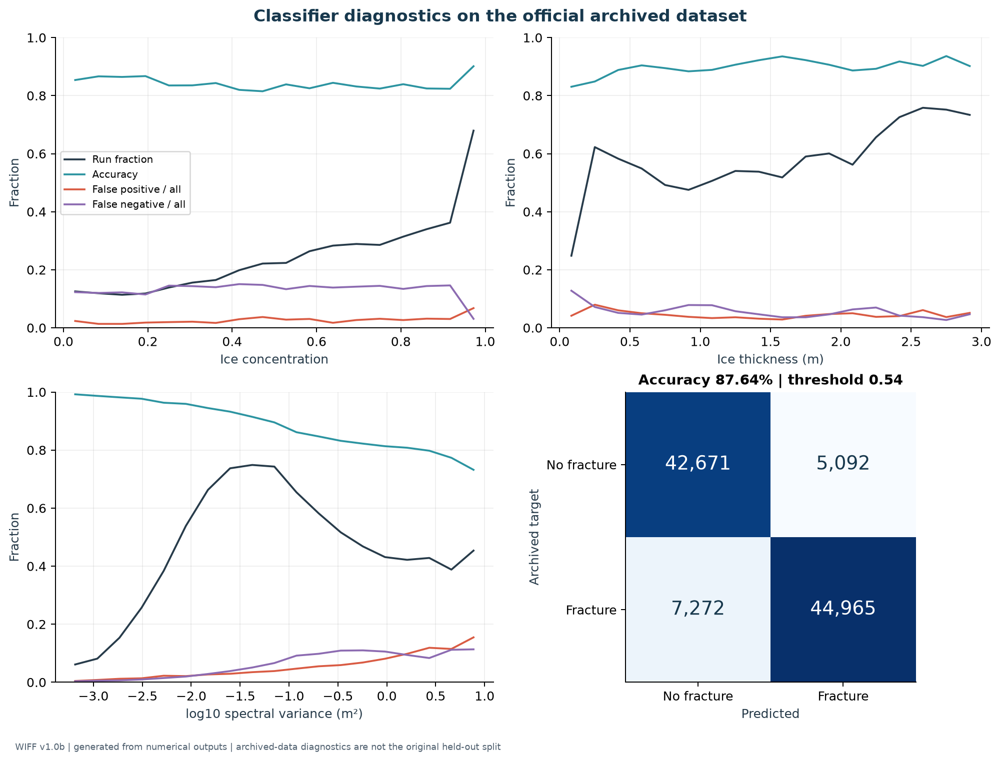
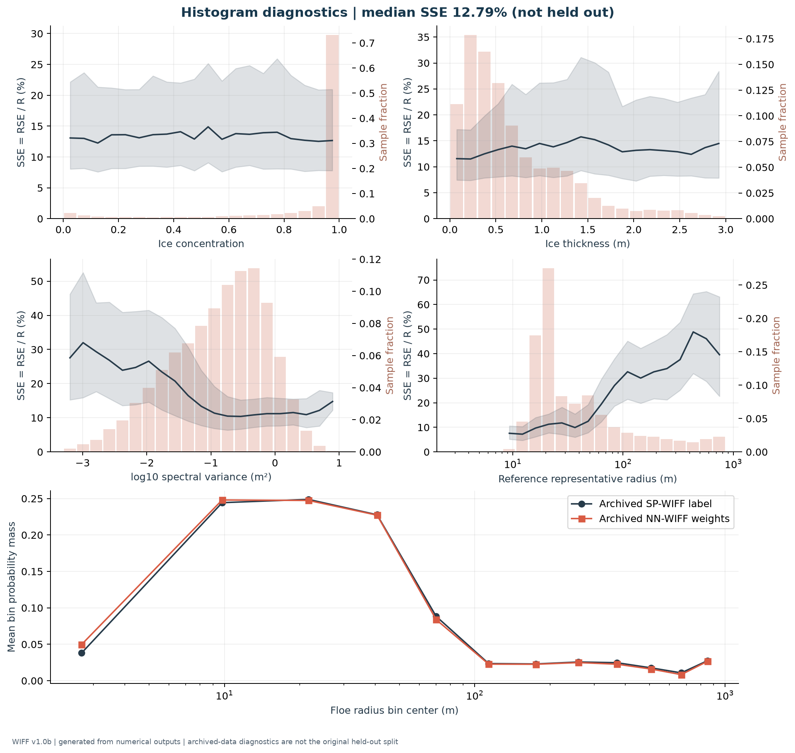
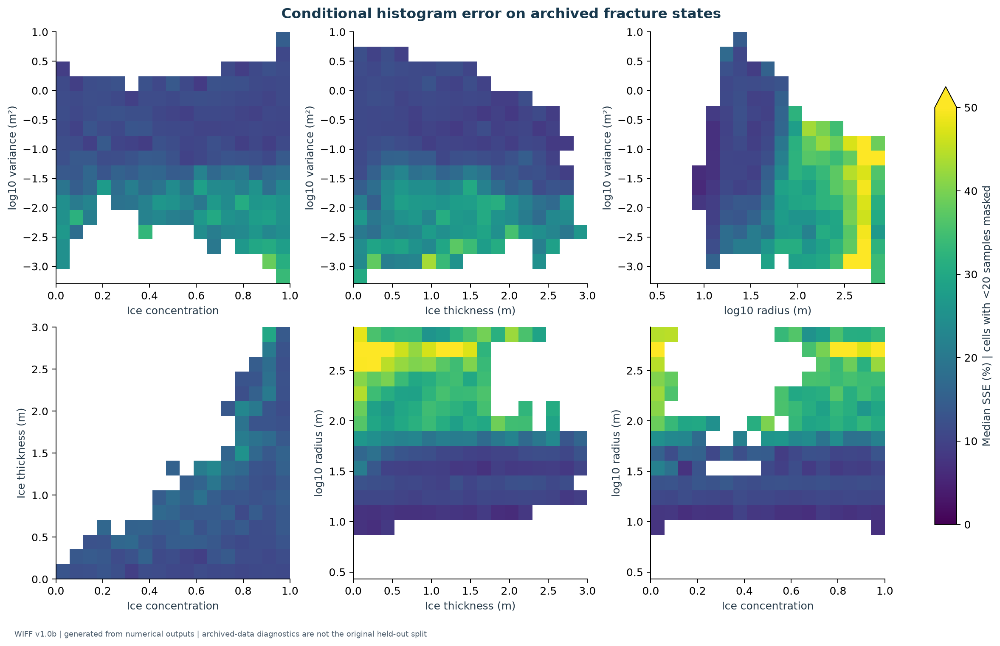
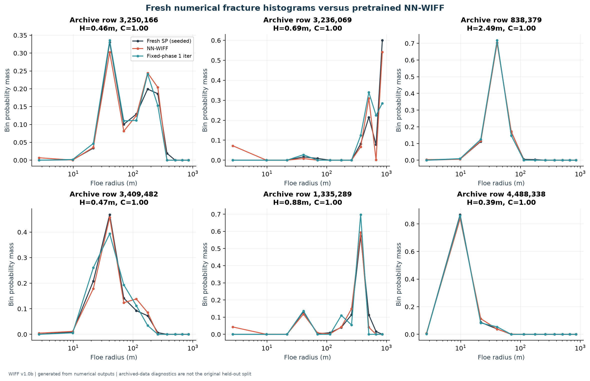
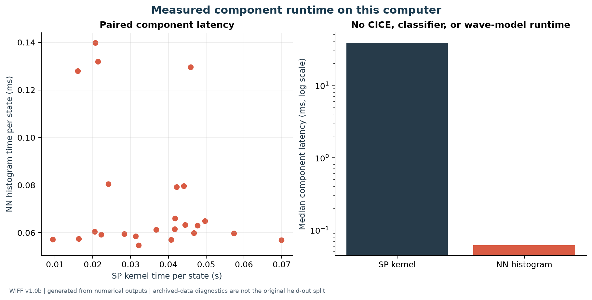
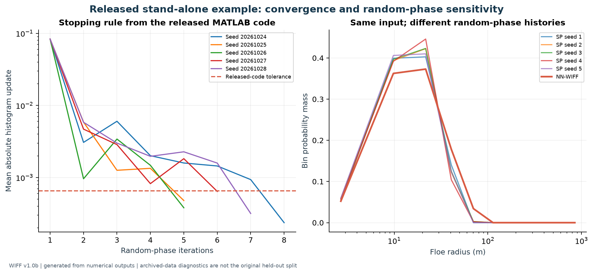
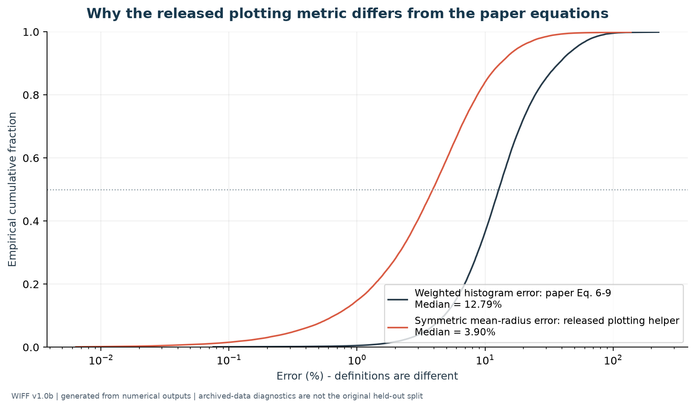

# WIFF1.0 Model Reproduction

Executable reproduction of the **local fracture and neural-network components** of Horvat and Roach (2022), with generated graphs, numerical outputs, tests, and pinned upstream model assets.

This component reproduction uses the authors' pretrained networks and official numerical training archive. It **does not retrain networks, rerun global CICE integrations, reproduce paper Figures 4-5, or validate a Great Lakes adaptation**. Archived-data diagnostics are not the original held-out test: the original train/validation membership is unavailable.

## Research objective

Reproduce the executable wave-induced floe-fracture mapping in WIFF1.0 and examine its accuracy, numerical behavior, and computational cost. The workflow connects the published physical fracture algorithm with the authors' neural-network surrogate, while keeping numerical emulation separate from observational validation and future Great Lakes adaptation.

## Reproduction workflow

1. Verify the official code release, pretrained weights, frequency bins, and floe-radius bins against pinned source checksums.
2. Download and verify the authors' official numerical dataset.
3. Evaluate the classifier and fracture-histogram network on a reproducible uniform sample of 100,000 archived states.
4. Run the Python port of SP-WIFF on 24 randomly selected physical states and compare fresh numerical histograms with neural and single-iteration predictions.
5. Measure component runtime, examine stochastic convergence, and save all generated figures and numerical evidence.

## Results at a glance

| Item | Executed result |
| --- | --- |
| Official archive | 5,087,436 physical states |
| Uniform archive sample | 100,000 states; seed 20261024 |
| Fracturing states in the sample | 52,237 |
| Classifier accuracy | 87.636% |
| Mean representative size error | 29.374 m |
| Median weighted histogram error, RSE / R | 12.789% |
| Median symmetric mean-radius error | 3.904% |
| Fresh SP-WIFF cases meeting the stopping criterion | 24 / 24 |
| Generated figures | 7, each available as PNG and vector PDF |
| Automated tests | 14 passed |

**The two percentage errors above measure different things.** The smaller value uses the released plotting helper's mean-radius definition; the weighted histogram error follows the paper's equations. The sample may overlap the original training data, so these are archive diagnostics rather than independent held-out performance. See [RESULTS.md](RESULTS.md) for the complete interpretation, fresh-kernel comparison errors, timing conditions, and limitations.

## Start here

- [Experiment and plotting code](reproduce.py)
- [Network and physical fracture implementation](wiff.py)
- [Measured results](RESULTS.md)
- [All graphs](figures/)
- [Numerical outputs and source provenance](results/)
- [Verification tests](test_wiff.py)

## Run it

Python 3.13 was used for the committed results. From this directory:

```sh
python -m venv .venv
# Windows: .venv\Scripts\activate
# macOS/Linux: source .venv/bin/activate
python -m pip install -r requirements-lock.txt
python fetch_data.py
python -m pytest -q
python reproduce.py --sample-size 100000 --sp-cases 24 --seed 20261024
```

The downloader fetches official `Training_converged.mat` (753,361,284 bytes; about 718 MiB), verifies its published MD5, and stores it in the ignored `data/` directory. Sampling is deterministic and reads chunks rather than loading the entire uncompressed archive into RAM. TensorFlow, MATLAB, a GPU, and CICE are not required: NumPy executes the archived dense layers directly. `requirements-lock.txt` records the tested versions; `requirements.txt` provides compatible ranges.

## Actual results and figures

See [RESULTS.md](RESULTS.md), [results/metrics.json](results/metrics.json), and [results/](results/) for measured values and numerical evidence. **Every graph below is generated by `reproduce.py`, not copied from the paper.** PNG and vector PDF versions are in [figures/](figures/).

### 1. Classifier diagnostics



Conditional run rates, false decisions, and a confusion matrix on the official archive. The FP/FN curves use all samples within each bin as denominator; global metrics also report class-conditional FPR/FNR. The gate is `P(fracture) >= 0.54`, following the second softmax component and archived Fortran code. The training notebook defines class 1 as fracture. This explicitly resolves the probability convention rather than reversing labels because of the differently described score in the paper.

### 2. Histogram diagnostics



Median and interquartile standardized size error versus concentration, thickness, variance, and representative radius, plus the mean twelve-bin histogram. This is an analogue of the paper's diagnostics, **not the original held-out validation split** or independent field validation.

### 3. Error across physical states



All six pairwise combinations of concentration, thickness, energy, and representative size. Cells with fewer than 20 samples are masked; colors show median error. States outside the displayed axis limits remain included in the global metrics.

### 4. Fresh SP-WIFF computations



New random-phase SP histograms from the Python port, compared with NN-WIFF and fixed-phase single-iteration calculations. Cases are chosen randomly from archived fracturing states, not by their errors. The first six are plotted; all selected inputs, outputs, and diagnostics are saved in `results/`.

### 5. Measured runtime



Measured latency with one BLAS thread. Weight loading and Fourier-basis precomputation are excluded. This compares the histogram network with the Python SP kernel, excluding classifier, CICE, wave-model, and I/O costs. **This is not the paper's whole-CICE speedup.**

### 6. Stochastic convergence



The exact physical example from `SP_WIFF_Standalone.m`, using five reproducible random seeds. The small successive-update stopping criterion is not a statistical confidence bound; different random histories can stop at different histograms.

### 7. Comparing the error definitions



On the same sampled fracture states, the released plotting helper gives a median symmetric mean-radius error of 3.90%, while the paper's weighted absolute histogram definition gives 12.79%. Their numerical difference is expected because mean-radius errors can cancel across bins. This is a source-definition discrepancy to document, not a reason to substitute one score for the other. See [RESULTS.md](RESULTS.md) for the formulas and measured values.

## Preserved numerical conventions

- Inputs: 25 direction-integrated frequency spectral densities, thickness, concentration; raw values without new normalization. Frequencies and radii come from archived `NN_params.mat`.
- Variance and height: `E = sum(S(f) * df)` in m²; `Hs = 4 * sqrt(E)`; `df = f * (sqrt(1.1) - sqrt(1/1.1))`.
- Outputs: twelve bin probability masses `q_i = A_i dr_i`, normalized when fracture occurs, all zero for no fracture. This is a fracture histogram, not the full prognostic FSD; do not multiply by bin width again.
- Networks: histogram `27 -> 100 -> 100 -> 100 -> 100 -> 100 -> 12`; classifier `27 -> 100 -> 100 -> 2`; ReLU hidden layers and row-wise softmax.
- Metrics: `RSE = sum(abs(q_pred - q_true) * r_i)`, `R = sum(q_true * r_i)`, `SSE = RSE / R`. SSE means standardized size error, not sum of squared errors.
- SP kernel: 10 km domain, 1 m spacing, +/-10 m extrema window, critical strain `3e-5`, diameter-to-radius conversion, radius-weighted counts, and last-category overflow.

## Source differences and limits

1. The paper states tolerance `5e-4`; released MATLAB/Fortran use `6.5e-4`. The default follows the code. `SPWIFF.run(tolerance=5e-4)` exposes the paper setting.
2. This Python kernel ports the stand-alone MATLAB code, including insertion of missing alternating extrema. CICE Fortran instead restricts strain to alternating triplets without inserting them. Its cap is 100 iterations; MATLAB uses 1000. The fresh comparison uses an explicit cap of 300. NumPy seeds do not reproduce MATLAB/Fortran random-number sequences.
3. The plotting helper `training_preamble.m` computes symmetric error of mean radius, which differs from the paper's weighted histogram RSE/R. The primary plots here use the paper's definition; the other metric is reported separately in `metrics.json`.
4. Pretrained weights may have seen sampled archive rows. An independent held-out claim needs the original split or retraining with a saved split. A fresh subset of the same archive does not establish independence.
5. Numerical targets inherit WIFF's physical assumptions. Agreement is not observational validation. No Great Lakes regional data are used here.
6. Multi-gigabyte global model-output files have not been processed; global climate maps, the climate-equivalence test, and whole-CICE runtimes are not reproduced.

## Files

```text
fetch_data.py          Official download and checksum validation
wiff.py                Dense networks, SP port, physical error metrics
reproduce.py           Seeded experiments and plotting
test_wiff.py           Numerical and archived-weight parity tests
requirements*.txt      Dependency ranges and tested versions
vendor/wiff-v1.0b/     Selected unmodified upstream code and weights
vendor/manifest.json   Archive identity and per-file SHA-256 values
figures/               Newly generated PNG/PDF graphs
results/               Metrics, selected inputs, outputs, provenance
data/                  Ignored raw archive and cache
```

## Sources and licensing

- Horvat and Roach (2022), [WIFF1.0 paper](https://doi.org/10.5194/gmd-15-803-2022).
- [Code release v1.0b](https://doi.org/10.5281/zenodo.5793692), root `chhorvat-WIFF-Model-cbbfa5b`, MD5 `d32f01372c49efa671233caa75cb9b45`.
- [Training data](https://doi.org/10.5281/zenodo.5108636), MD5 `84547e2fcfa2821ccf9a2dd3057c3588`.
- [Global model output](https://doi.org/10.5281/zenodo.5106703), cited for completeness, not processed here.

Unmodified upstream assets retain their [MIT license](vendor/wiff-v1.0b/LICENSE), copyright Christopher Horvat (2021). The Python SP kernel is an attributed port of that code. Original notebooks are retained for provenance; execution uses the new Python scripts above.
